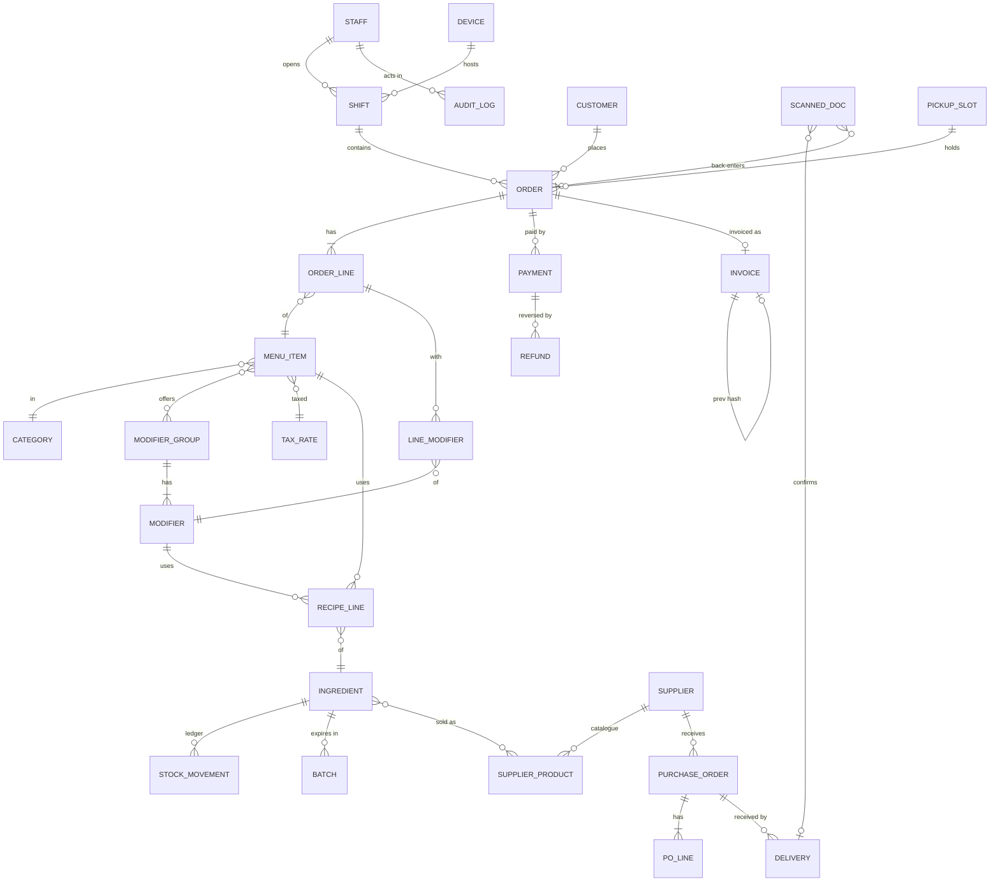

# maisha matcha platform: audit and phased plan (section 0)

Response to `2026-11-05-maisha-pos-build-prompt.md`, section 0. Written
2026-11-05. Nothing in sections 1 to 10 is built yet. Phase 1 starts only after
the owner approves this plan and answers the open questions.

## 1. Audit of the current repository

### Stack

| Layer | Today |
|---|---|
| Framework | Next.js 15.5 (App Router), React 19, TypeScript strict |
| Styling | Tailwind CSS 4, brand tokens in `app/globals.css`, brand law in `.claude/skills/maisha-brand` |
| i18n | next-intl, `/es` default and `/en`, localized pathnames |
| CMS / admin | Payload CMS 3.88 embedded at `/admin` |
| Database | SQLite file locally; Postgres in production via `DATABASE_URL` (Supabase, not yet created) |
| Auth | Payload's built-in email + password auth on `users`, roles `admin` and `staff` |
| Email | Resend (waitlist confirmation), React Email templates |
| Hosting | Vercel, auto-deploy from GitHub `main`, CI on GitHub Actions |
| Payments | None |
| Tests | None (no test runner installed) |

### What works

- Public bilingual site: home, carta, historia, eventos, legal pages, waitlist.
- Recipe builder `/crea`: four steps, price, ratio, color blend, share URL, QR card.
- Payload admin with 11 collections, branded theme, seeded locally
  (menu, recipe options, events, story chapters, first admin user).
- Append-only stock ledger idea: `StockMovements` updates a cached `stock`
  on `InventoryItems`.

### Half built

- Production admin: code is deployed, but there is no database yet, so
  nothing persists on Vercel.
- Public pages still read `content/*.ts`, not the CMS.
- `Orders` is a single-line status board: no order lines, no payments, no
  tax, no staff attribution.
- `Members` exists as an admin-managed list; no customer login.
- Inventory has items and a ledger, but no recipes, suppliers, or purchase
  orders.

### Broken or risky (fix in Phase 1 regardless of scope)

1. **Hardcoded fallback secret.** `payload.config.ts` falls back to a known
   string when `PAYLOAD_SECRET` is missing. In production that would make
   admin sessions forgeable. Production must refuse to start without it.
2. **Delete and edit rights are too wide.** Payload's default lets any
   signed-in user create, update and delete in collections that only define
   `read`. Today any staff account can delete orders or members. Financial
   records must never be deletable.
3. **Stock counter race.** The ledger hook reads the stock, adds the delta,
   and writes it back, outside the request transaction. Two sales at once
   can lose an update. The `stock` field is also only read-only in the UI,
   not in the API.
4. **No database migrations.** Postgres in production needs generated Payload
   migrations; none exist yet.
5. **Version conflict.** Payload 3.88 officially supports Next `15.4.11 to
   <15.5` or `16.2.6+`; the repo runs Next 15.5. It builds and deploys, but
   strict dependency installs fail. The clean fix is Next 16, which also
   clears the three accepted `npm audit` highs noted in CLAUDE.md.
6. **No tests.** Section 10 requires tests for money, tax, stock, sync,
   refunds and permissions.
7. Fixed today: the seed script silently did nothing (`payload run` exits
   before async work). It now runs through `tsx` with top-level await.

## 2. Stack decision

Keep the stack. Next.js + Payload + Supabase Postgres + Vercel can carry
every requirement. Payload is the back office (menu, staff, inventory,
suppliers, purchase orders, reports as custom admin views). The POS and the
kitchen display are separate, purpose-built Next routes (`/pos`, `/kds`) that
call server actions backed by Payload's local API, so every role check runs on
the server.

Changes that need owner approval:

| Change | Why |
|---|---|
| Next 15.5 to Next 16 | Resolves the Payload peer conflict and the audit findings |
| Add Vitest | Required tests for money, tax, stock, sync, permissions |
| Payment provider SDK (Stripe recommended) | One provider for card terminal, online card, Apple Pay and Google Pay |
| A certified VERI*FACTU provider API | See section 4; building and certifying the AEAT submission ourselves is costly |
| Service worker + IndexedDB for the POS | Offline queue; no new framework |
| OCR provider for scanning | Claude vision API recommended (reads supplier invoices well); human confirm always |
| Animation library for the drink builder (only if approved) | Brand law currently bans animation libraries; see question 14 |

## 3. Data model

Money is integer cents plus currency. Tax rates are records, not constants.
Financial and stock records are append-only: corrections are new records.

Notes on key records:

- **Staff** (Payload `users`): role `owner | manager | barista`, PIN hash,
  refund limit in cents, active flag. **Customers** are a separate auth
  collection, never mixed with staff (GDPR).
- **Device**: the counter tablet the owner signed in once; PIN login only works
  on a registered device.
- **Order**: channel `counter | online | table`, status `received |
  preparing | ready | collected | cancelled`, client-generated idempotency key
  (unique) so an offline sale synced twice is stored once.
- **Order line**: snapshots name, unit price, tax rate and modifiers at sale
  time, so later menu edits never change history. The barista can override
  recipe grams per line (the founder's "measured scoop" rule), and the
  override is what the ledger deducts.
- **Invoice**: series, sequential number, type `simplificada | completa`,
  hash of this record chained to the previous one, QR payload, AEAT
  submission status. Never edited or deleted; credit notes are new invoices.
- **Stock movement**: reason `sale | waste | count | purchase | adjustment`,
  links to the order line, delivery or count that caused it, and to the
  staff member. The cached stock updates inside the same transaction with an
  atomic increment.
- **Audit log**: who, when, what, why, before and after, for refunds,
  discounts, voids, stock adjustments and price changes.

## 4. Spain invoicing compliance (VERI*FACTU)

Current dates, set by Real Decreto-ley 15/2025 (BOE 3 December 2025):

| Who | Must comply from |
|---|---|
| Companies paying Impuesto sobre Sociedades (an SL) | 1 January 2027 |
| Autónomos and other taxpayers | 1 July 2027 |

Which date applies depends on the legal form of the business (question 1).
If maisha is an SL and trades with this POS on or after 1 January 2027, the
POS must be compliant on day one.

What the system needs, which we will implement and not merely claim:

1. An invoice record per sale with the required fields, chained by hash to
   the previous record, never deleted or silently changed.
2. A QR code and the "VERI*FACTU" legend on every simplified invoice.
3. Sending each record to the AEAT in near real time (VERI*FACTU mode), or
   keeping a signed, tamper-evident local log (non-VERI*FACTU mode).
4. An event log, and a "declaración responsable" from the software producer.

Recommendation: generate the records and hash chain in our own database,
and submit them through a certified VERI*FACTU provider's API. That puts the
producer declaration and AEAT certificate handling on the provider. Confirm
the final setup with your gestor before go-live.

## 5. Phased plan

Dates assume work starts the week of 9 November 2026 and owner reviews
within two working days at each gate. Each phase ends with a demo, a change
list and a device test checklist.

| # | Phase | Contents | Dates |
|---|---|---|---|
| 1 | Foundations | Fix the audit risks, Next 16, Vitest, migrations, Supabase live; roles owner/manager/barista + device registration + PIN login; audit log; tax rates; menu with allergens, modifiers and channel prices; design mocks for POS order screen and KDS | 9 to 27 Nov |
| 2 | POS | Counter order screen, cash with change, card terminal, split payment, refunds and voids with reasons and limits, shifts with float and Z report, receipt printing, offline queue, KDS, invoice records with hash chain and VERI*FACTU submission | 30 Nov to 8 Jan |
| 3 | Inventory | Recipes for items and modifiers, automatic deduction with gram overrides, counts, waste, batches and expiry, alerts, cost per drink and margin | 11 to 29 Jan |
| 4 | Suppliers | Supplier directory and catalogue, draft purchase orders at reorder point, one-tap approval, PDF email, receiving, delivery note and paper-ticket scanning with confirm step | 1 to 19 Feb |
| 5 | Website ordering | Pickup and pre-order slots, online card + Apple Pay + Google Pay, status page and ready notification, guest checkout and optional accounts, orders in the KDS queue, CMS-backed public pages | 22 Feb to 19 Mar |
| 6 | Drink builder | Mock first, then the live drink, saved and shareable recipes that become real orders | 22 Mar to 9 Apr |
| 7 | Reports and launch | Owner dashboard, reports, CSV/Excel exports, IVA summary, compliance hardening, backup and restore test, owner runbook and staff training notes | 12 Apr to 7 May |

If the business is an SL, the invoice hash chain and AEAT submission move
to the front of Phase 2 so the counter is compliant from 1 January 2027.

## 6. Owner answers (2026-11-05)

| # | Question | Answer | Consequence |
|---|---|---|---|
| 1 | Legal form | Registered under the parent company | Almost certainly pays Impuesto sobre Sociedades: VERI*FACTU from **1 January 2027**. Confirm with the gestor |
| 2 | Opening | Saturday 7 November 2026 | Our POS cannot be ready. Use a stopgap till until the new counter goes live (below) |
| 3 | Payments | Stripe on the website | Counter card terminal still open: Stripe Terminal readers work in Spain |
| 4 | Hardware | Probably Android tablet | Build is browser-based, tested at tablet and 390px widths |
| 5 | IVA | "Both" (dine-in and takeaway) | Seeded IVA 10 % (hostelería) as default and 21 % general. Gestor to confirm |
| 6 | VERI*FACTU software | None | Free tier constraint: submit to AEAT directly with the company's certificate (no paid provider) |
| 7 | Hours | 8:00 to 18:00 | Pre-order slots in Phase 5 |
| 8 | Suppliers | Netherlands now, Japan later | Supplier records in Phase 4 |
| 9 | Menu | Founder's carta PDF | Loaded as `content/carta.ts` (see below) |
| 10 | Staff | 3 baristas, may grow | Roles and PIN login built |
| 11 | Loyalty | CafeRadar stamp card | No loyalty built here. Integrate in Phase 5 |
| 12 | Customers | Founding-member list becomes accounts | Phase 5 |
| 13 | Languages | Spanish and English | As today |
| 14 | Design | Current brand, made premium | Brand law kept. No dark mode, no animation library |
| 15 | Budget | Free services only | Supabase free, no paid APIs. Caveat: Vercel Hobby forbids commercial use |

### Saturday stopgap

From Saturday until the counter goes live, sell with a simple till or the
card terminal's own app and keep paper tickets. VERI*FACTU is not yet
mandatory before 2027, and the back-entry scanner planned in Phase 4 can
import those tickets later.

### Carta notes to confirm

- Zumo de naranja 9,50 € and Yuzu 9,80 € are much higher than the teas.
  Seeded as printed. Please confirm they are not typos.
- Milks: the carta says "la leche que prefieras, también vegetal de avena".
  Seeded Leche and Avena. Add any other milks in the admin.
- Allergens are filled only where the law makes them certain (milk, oats,
  pistachio, cheesecake). Mochi fillings and extras need the supplier sheets.

## 7. Phase 1 status (2026-11-05): done locally

- Next 16, Payload 3.93, Node 24, clean strict lockfile.
- Postgres everywhere (docker locally, throwaway database per test run,
  Supabase in production) with committed migrations in a `payload` schema.
- Roles owner, manager and barista enforced on the server. Staff never
  deleted. Orders, stock movements and audit records never deleted.
- Audit log for prices, availability, staff changes, PINs, waste,
  adjustments, device registration and every counter sign-in.
- IVA rates, EU allergens, channel prices, option groups, the real carta.
- Stock ledger with one atomic increment per movement inside the transaction.
- Counter: tablet registration by the owner, name and PIN sign-in on that
  device only, five attempts then a 15 minute lock (atomic, so parallel
  guesses cannot bypass it), sessions bound to person, device and PIN.
- 48 automated tests on Postgres plus a 14-step browser check.
- Security review and code review run. Both blockers and the other
  security fixes are resolved. Still open from the code review: removing
  the remaining type casts in the audit writer, typed adapter access in
  `cms/db.ts`, audit tests for availability and staff-field changes, an
  `unknown-staff` vs `wrong-pin` merge (harmless, the device already shows
  names), and a refund rounding rule for negative amounts (Phase 2).
- Phase 2 mocks for approval: order screen, options sheet, cash payment
  offline, kitchen display.

### Go-live checklist for Phase 1

1. Create the Supabase project (EU region) and copy the transaction pooler URI.
2. In Vercel, Production environment only: `DATABASE_URL`, `PAYLOAD_SECRET`
   (`openssl rand -base64 48`), `FIRST_OWNER_EMAIL`, `NEXT_PUBLIC_SITE_URL`.
3. From this Mac: `DATABASE_URL=<uri> npm run migrate && DATABASE_URL=<uri> npm run seed`,
   then create the owner at /admin with the FIRST_OWNER_EMAIL address.
4. In Supabase, check the `payload` schema is not under API, Exposed schemas.
5. Push to main. On the tablet: sign in to /admin as owner, open /pos/registrar.

## 8. Build backlog

Done 2026-11-06 beyond the table: split payment, full invoice on request (F3), emailed receipts. Not built yet: supplier delivery-note and paper-ticket scanning (OCR, free option: in-browser Tesseract; plan suggested Claude vision, which is paid), PDF purchase orders (emails are HTML today), table ordering by QR (optional), corrective for full invoices (R1 to R4: ask the gestor).
 (founder go-ahead 2026-11-05: "implement every feature")

Mocks approved by the founder's instruction to build everything. Order of
work, each step committed with tests before the next:

| Step | Feature | Needs from the founder |
|---|---|---|
| 2a | Order model: lines, option snapshots, server-priced totals, IVA breakdown, idempotency | none |
| 2b | Shifts: open with float, close with count, Z report | none |
| 2c | Counter order screen + options sheet + measured grams (mocks 1 and 2) | none |
| 2d | Cash payment with change; "card on external terminal" recorded by the barista | none |
| 2e | Invoice records: series, sequential number, SHA-256 hash chain, QR payload, receipt page (print/QR) | NIF, legal name, address (settings) |
| 2f | Kitchen display /kds (mock 4), status flow, timers | none |
| 2g | Refunds and voids with reasons, barista limits, manager approval | none |
| 2h | Offline queue for cash sales (idempotent sync) | none |
| 2i | Stripe Terminal card payments | Stripe account + reader |
| 2j | VERI*FACTU submission to AEAT | company e-certificate, gestor sign-off |
| 3 | Inventory: recipes (BOM), auto-deduction incl. measured grams, counts, waste, batches, alerts, margin | ingredient costs |
| 4 | Suppliers + draft purchase orders + approval + email + receiving | supplier list |
| 5 | Website ordering: pickup slots, pre-order, status page, accounts, CafeRadar stamps. DONE 2026-11-05: slots with capacity, pay at pickup or Stripe Checkout (webhook), live status page, emails, KDS label. Open: customer accounts, CafeRadar stamps | Stripe keys (online pay), Resend key |
| 6 | Drink builder: saved/named recipes, share card, recipe becomes an order. DONE 2026-11-05 (the real tinted drink photo stays as the visual; an animated layered drink was not rebuilt) | none |
| 7 | Reports, owner dashboard, exports, IVA summary, runbook | none |
| + | Founding membership (Stripe), events RSVP, email campaigns, customer accounts: DONE 2026-11-06. CMS-backed pages: events only (carta and story stay in code on purpose) | Stripe, Resend keys; founding price, IVA, places |
